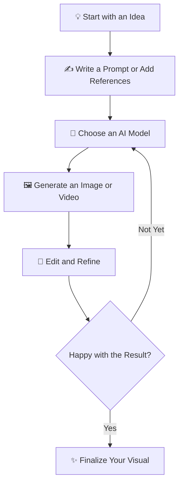

# PalaPili — AI Image & Video Creation on an Infinite Canvas

**One Canvas. Multiple AI Models. Endless Creative Possibilities.**

PalaPili is an AI-powered visual creation studio that brings image generation, video creation, and AI-powered editing into one workspace. Explore ideas, compare models, refine visuals, and build on your best results without constantly switching between tools.

🌐 **Website:** [https://palapili.com](https://palapili.com)  
🎨 **Start Creating:** [Open PalaPili Studio](https://palapili.com/studio/image)

---

## ✨ What Is PalaPili?

Creating great visuals often means juggling different AI tools, repeating prompts, and moving files between applications.

PalaPili brings your creative process together in one place. Use multiple AI models to explore visual ideas, generate images and videos, edit existing photos with natural-language instructions, and refine promising results through an iterative workflow.

Whether you're developing a concept, producing marketing assets, or experimenting with visual styles, PalaPili helps you move from an initial idea to a more polished result.

## 🚀 Key Features

### 🖼️ AI Image Generation

Turn text prompts and visual references into images with a selection of AI models. Explore different styles, compositions, and creative directions from one workspace.

- Generate images from natural-language prompts
- Explore different models and visual styles
- Use reference images to guide your results
- Iterate on concepts to discover stronger variations

### 🎬 AI Video Creation

Bring visual ideas to life with AI-powered video generation. Explore motion-based storytelling and create visual content for creative projects, campaigns, and social media.

- Turn creative ideas into video concepts
- Explore supported video-generation models
- Develop visual ideas through an iterative workflow

*Available options depend on the selected model and current product capabilities.*

### 🎨 AI Photo Editing

Edit existing images by describing the changes you want in natural language. Refine a photo without having to recreate the entire image from scratch.

- **Generative inpainting:** Modify selected areas of an image
- **Background replacement:** Create a different setting for your subject
- **Object removal:** Remove unwanted elements
- **Lighting and color refinement:** Adjust the visual atmosphere
- **Image upscaling:** Enhance image detail and resolution

Explore the [AI Photo Editor](https://palapili.com/ai-photo-editor).

### ♾️ Infinite Canvas Workspace

Keep creative exploration and refinement in a visual workspace instead of scattering your work across multiple tools and tabs.

- Organize ideas and visual references
- Explore alternative creative directions
- Revisit and refine generated results
- Build on existing images throughout the creative process

### 🔄 Multi-Model Creative Workflow

Different AI models excel at different tasks. PalaPili brings multiple image and video generation options together so you can choose an engine that fits your creative goal.

Move between idea exploration, generation, editing, and refinement in one connected workflow.

## 🛠️ How It Works

1. **Start with an idea** — Describe what you want to create or upload an existing image.
2. **Choose your tools** — Select an available AI model and configure its supported options.
3. **Create and explore** — Generate visuals and experiment with different directions.
4. **Refine your results** — Use AI editing and iterative improvements to get closer to your vision.
5. **Finalize your work** — Continue refining or use your finished visual in your creative projects.

## 👥 Who Is PalaPili For?

PalaPili is designed for people who create, communicate, and tell stories through visuals.

- **Designers:** Explore concepts, compositions, and visual directions.
- **Content creators:** Produce images and videos for digital content.
- **Marketers:** Develop campaign visuals, promotional assets, and creative variations.
- **E-commerce teams:** Experiment with product imagery and marketing visuals.
- **Artists and visual storytellers:** Explore styles and turn ideas into visual experiments.
- **Creative teams:** Bring visual exploration and AI-assisted production into a shared creative workflow.

## 💡 Why PalaPili?

| Challenge | How PalaPili Helps |
|---|---|
| Switching between multiple AI tools | Access multiple supported models in one studio |
| Starting over to change an existing image | Refine images with AI-powered editing |
| Losing track of creative directions | Explore ideas on an infinite canvas |
| Repeating the same manual editing steps | Use natural-language instructions for supported edits |
| Searching for the right visual style | Experiment with models, prompts, and variations |

## 🌐 Get Started

Ready to explore your next creative idea?

- **Website:** [palapili.com](https://palapili.com)
- **AI Image & Video Studio:** [Start Creating](https://palapili.com/studio/image)
- **AI Photo Editor:** [Edit Images with AI](https://palapili.com/ai-photo-editor)

Visit the website to explore current features and available plans.

## 🏢 About

PalaPili is developed by **Crownbyte Ltd.**, a software company building AI-powered tools and digital products that help people create and work more efficiently.

## 🤝 Feedback & Contact

Have feedback, ideas, or questions about PalaPili?

Visit [PalaPili](https://palapili.com) to explore the product and find the available support options.

If you're viewing this repository on GitHub, you can also use the repository's **Issues** tab to report documentation or repository-related problems.

---

  <strong>PalaPili</strong> 
  Create more. Explore further. All on one canvas.

  Built by Crownbyte Ltd. © 2026 PalaPili.

